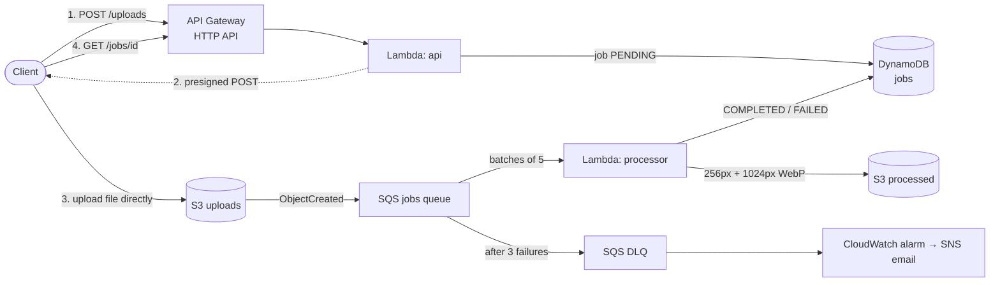

# Serverless Image Pipeline on AWS

[](https://github.com/NikitaManasa/image-pipeline/actions/workflows/ci.yml)

An event-driven, fully serverless image-processing pipeline on AWS, defined entirely in
**Terraform** and deployed by **GitHub Actions through OIDC** (no AWS keys stored anywhere).
Clients upload straight to S3 with presigned URLs. Uploads flow through SQS to a Lambda that
validates each image, strips private metadata and produces web-ready renditions. Failures are
retried, dead-lettered and alarmed on. Nothing runs, and nothing costs money, while it's idle.



## API

| Request | Response |
|---|---|
| `POST /uploads` `{"filename": "cat.jpg", "content_type": "image/jpeg"}` | `201` with `job_id` and a presigned S3 POST (`url` + `fields`) valid for 15 min |
| `GET /jobs/{job_id}` | status `PENDING_UPLOAD → PROCESSING → COMPLETED / FAILED`, image metadata, and short-lived download links |

## Design decisions

- **Uploads bypass Lambda.** Clients POST directly to S3 using a presigned POST, so API Gateway's
  10 MB limit doesn't apply and no Lambda time is spent moving bytes. The presigned *POST*
  (rather than PUT) lets S3 itself enforce the size limit and content type.
- **S3 → SQS → Lambda, not S3 → Lambda.** The queue absorbs bursts, `maximum_concurrency = 2`
  caps cost, failures are retried, and a message that fails 3 times moves to a dead-letter
  queue that triggers an alarm.
- **Permanent vs. transient errors.** A corrupt or fake image marks the job `FAILED` and the
  message is deleted, because retrying would never help. Anything else (throttling, network) is
  returned as a **batch item failure**, so only that one message is retried, not the whole batch.
- **Idempotent processing.** S3 and SQS deliver *at least once*. A conditional DynamoDB update
  claims each job, so a duplicate delivery is skipped. A crash mid-processing can still be
  retried, because `PROCESSING` is claimable again.
- **Every upload is treated as hostile.** The processor checks the *actual* file format rather
  than the claimed content type, rejects decompression bombs (a tiny file that expands to 49
  megapixels), and re-encodes the image, which strips EXIF data such as GPS location.
  Filenames are sanitised so S3 keys can't escape their prefix.
- **Least-privilege IAM.** Each Lambda has its own role, limited to specific actions on specific
  key prefixes (for example, the API can only sign uploads under `uploads/*`).
- **Cost controls.** Pay-per-request DynamoDB, S3 lifecycle rules (uploads expire after 1 day,
  outputs after 7), DynamoDB TTL on old jobs, 14-day log retention, API throttling, and a $5
  monthly budget alert.
- **Deterministic builds.** `scripts/build.py` produces byte-identical zips for identical code,
  so Terraform only redeploys a function when its code actually changed. Pillow is fetched as
  the Amazon Linux wheel even when building on Windows.

## Security

| | |
|---|---|
| **CI → AWS auth** | GitHub Actions assumes an IAM role via **OIDC**. The trust policy only accepts the `main` branch of this repo, and no long-lived keys exist. |
| **Data** | Buckets are private (public access blocked, ACLs disabled), encrypted, and HTTPS-only by bucket policy. SQS is encrypted, and DynamoDB has point-in-time recovery. |
| **IaC scanning** | Every push runs **Checkov**. Each skipped check is a documented trade-off in [.checkov.yaml](.checkov.yaml), such as customer-managed KMS keys being out of budget for a demo. |
| **Observability** | JSON logs (filter by `job_id` in Logs Insights), X-Ray tracing, API access logs, 4 alarms, and a CloudWatch dashboard. |

## Repository layout

```
src/pipeline/       api.py (HTTP handler), processor.py (SQS worker), images.py (pure image logic), jobs.py (DynamoDB)
tests/              42 tests; AWS is mocked with moto, so no account is needed
infra/              Terraform: S3, SQS + DLQ, Lambda, API Gateway, DynamoDB, IAM, alarms, dashboard
infra/bootstrap/    one-time CloudFormation: GitHub OIDC role, Terraform state bucket, budget alert
scripts/            build.py (Lambda packaging), demo.py (live smoke test)
.github/workflows/  ci.yml (lint, tests, build, terraform validate, Checkov), deploy.yml (manual apply/destroy)
```

## Run the tests (no AWS needed)

```powershell
python -m venv .venv
.\.venv\Scripts\pip install -r requirements-dev.txt
.\.venv\Scripts\pytest
```

## Deploy to your own AWS account

1. **Bootstrap (once).** In the AWS console, open CloudFormation → *Create stack* → *Upload a template file*,
   choose [infra/bootstrap/bootstrap.yaml](infra/bootstrap/bootstrap.yaml), and enter your email for the
   budget alert. When it finishes, copy the `DeployRoleArn` output.
2. **Connect GitHub.** In the repo, go to *Settings → Secrets and variables → Actions → New repository secret*.
   Name it `AWS_DEPLOY_ROLE_ARN` and paste the ARN.
3. **Deploy.** Go to *Actions → Deploy → Run workflow → apply*. This runs Terraform, then uploads a
   real image (and a fake one) through the live API to verify the deployment. The run summary
   shows the API URL and dashboard link.
4. **Tear down** when you're done: *Run workflow → destroy*.

## Roadmap

- [ ] Cognito JWT authorizer on the API and per-user job ownership
- [ ] Static upload page served from S3 + CloudFront
- [ ] DLQ redrive tooling and a runbook
- [ ] Image moderation with Amazon Rekognition
